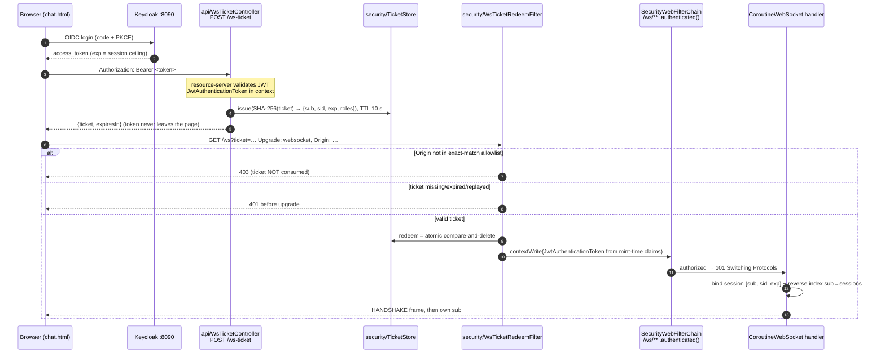
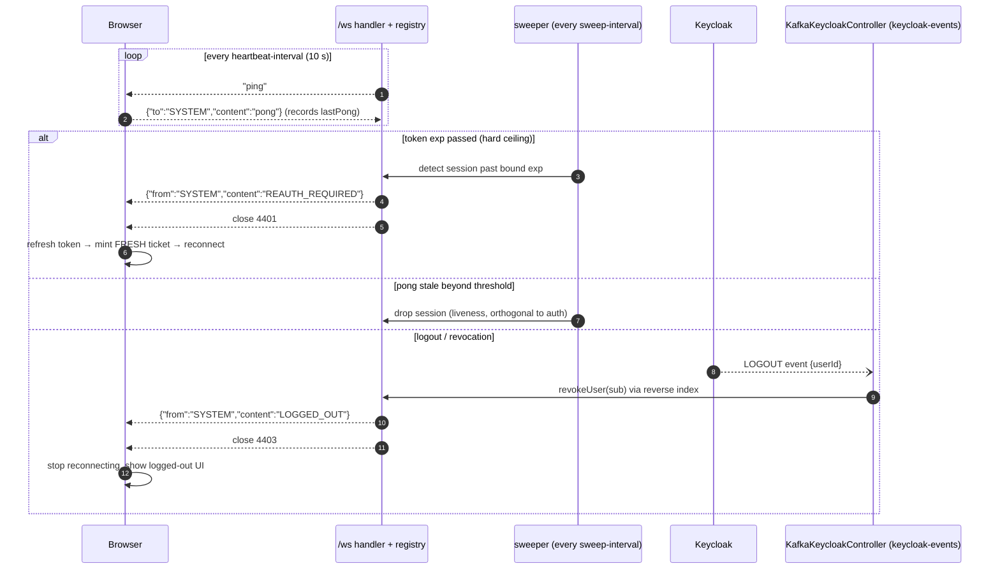

# ADR-0001: WebSocket chat authentication via one-time tickets

- **Status:** Accepted (implemented on `feat/ws-ticket-auth`)
- **Date:** 2026-11-01
- **Context:** WebSocket chat feature (coroutine WebFlux at `/ws`, today `notifications/ws` — see ADR-0003 for the package restructure), Keycloak/OAuth2 resource server, Kafka event bridge for Keycloak auth events
- **References:** RFC 6455 §10.2/§10.5/§7.4.2, RFC 9700 (BCP 240) §4.3.2, RFC 10017, OWASP CSWSH (CWE-1385); skills `websocket-auth-session-lifecycle`, `spring-webflux-coroutine-websockets`

## Context

The WebSocket chat endpoint originally required `ROLE_ADMIN` via an `Authorization`
header on the HTTP **upgrade** request. The browser `WebSocket` constructor accepts
only `(url, protocols)` — `Authorization` and `Sec-*` headers are forbidden by
WHATWG Fetch — so the header scheme made the browser flow **impossible**, leaving
only non-browser clients (`.http`, server-to-server).

The credential carriers available to a browser handshake are exactly: **URL,
subprotocol, first frame, cookie**. The candidate designs:

| Option | Auth at handshake | Token exposure | Complexity | Fit here |
|---|---|---|---|---|
| **One-time ticket** | ✅ before upgrade | none (opaque, single-use, 10 s) | medium | ✅ stateless SPA holding JWTs |
| `?access_token=<JWT>` | ✅ | **forbidden** — RFC 9700 §4.3.2 MUST NOT | trivial | ❌ |
| First-frame auth | ❌ brief unauthenticated window | none | med–high (+ timeout, caps, re-auth state machine) | ⚠️ viable, more moving parts |
| `Sec-WebSocket-Protocol: bearer.<jwt>` | ❌ | leaks to header logs; unstandardized subprotocol echo | medium | ❌ last-resort hack |
| Cookie / BFF | ✅ | none | requires a BFF architecture change | ❌ no BFF in this template |

A second, independent problem: WebSocket auth is enforced **once**, but the socket
outlives the access token that authorized it. Two failure modes must be bounded:
the token `exp` passing while the socket lives, and user logout while a still-valid
token keeps the socket alive. Handshake auth alone never solves either.

## Decision

Use the **one-time ticket** pattern for `/ws` handshake auth, plus a
**session-identity binding with sweeper + event revocation** for lifecycle.

### Connect flow

### Lifecycle: ceiling, liveness, revocation

Key invariants:

1. **Identity is asserted once, from a validated credential, at mint time.** Frames
   never assert identity — the server stamps `from` with the session's bound `sub`.
2. **The ticket is the only credential allowed in the socket URL**, and only because
   it is opaque, single-use (atomic compare-and-delete), and 10 s-lived.
   `?access_token=` is never acceptable (RFC 9700 MUST NOT).
3. **The ceiling is hard.** The sweeper enforces `exp` even when every event path
   works; Kafka LOGOUT events only shorten the window. Keycloak logout does *not*
   revoke issued access tokens — keep access tokens short.
4. **Origin is an exact-match allowlist on every handshake** (CORS config gives the
   upgrade zero protection). Absent Origin (non-browser clients) is allowed —
   browsers always send it, so absence implies no ambient browser credentials.
5. **No secret in logs**: tokens, raw tickets, and full claim sets never appear in
   application logs; the store keeps only SHA-256(ticket).

### Failure contract (client-facing API — stable)

| Situation | Response | When |
|---|---|---|
| No/invalid bearer on mint | `401` | security chain (+ controller defense) |
| Ticket unknown / TTL passed / token ceiling passed / replayed | `401` pre-upgrade | redeem filter + store |
| Foreign Origin | `403` pre-upgrade, ticket not consumed | redeem filter |
| Anonymous `/ws` upgrade, no ticket | `401` | security chain (`.authenticated()`) |
| Token expires mid-socket | `REAUTH_REQUIRED` → close **4401** | sweeper |
| Logout event | `LOGGED_OUT` → close **4403** | Kafka consumer + reverse index |
| Pong stale | session dropped | sweeper |

## Consequences

**Positive**

- Browser chat works end-to-end without a BFF, cookies, or CORS reliance; the
  header-based flow for non-browser clients keeps working (ticket-less upgrades
  fall through to the security chain).
- Revocation window is bounded by `min(LOGOUT event latency, exp + sweep interval)`.
- The connect seam is swappable: migrating later to first-frame auth or a BFF
  changes only step 2–3 of the connect flow; registry, reverse index, sweeper,
  close-code contract, and reconnect logic survive (≈80 % of the machinery).
- Everything is removable per the feature-removal contract: `notifications/ws/**`
  (`api/`, `security/`), `web/chat.html`, `com.softeno.ws.*` keys, two
  `SecurityConfig` rules (the static dev page moved to the shared `web/` tools dir).

**Negative / accepted costs**

- One extra round trip per connect (`POST /ws-ticket`); one extra hop per reconnect.
- In-memory ticket store, session registry, and reverse index are **per-process**:
  a single instance is fine, multi-instance requires (a) an externalized or
  instance-pinned ticket store and (b) a **per-instance consumer group** on
  `keycloak-events` so every instance receives every LOGOUT — a shared group
  load-balances each event to one, possibly wrong, instance. Marked `# VERIFY` in
  code comments.
- Reconnect churn costs a mint each time; if that is ever proven costly, add
  in-band re-auth (expiry policy B) on top — same architecture, second auth path.
- Tickets in URLs can appear in access logs of *proxies*; mitigated by TTL/single-use
  and by redacting `ticket=` in the app's error handler. TLS (`wss://`) is mandatory
  everywhere except loopback dev.

## Alternatives considered

- **First-frame auth** — OWASP-endorsed, avoids the URL entirely, but requires an
  unauthenticated-window state machine, auth timeout (~10–15 s), per-connection caps,
  and (for zero-reconnect refresh) an in-band re-auth protocol. Not worth it without
  proven reconnect-churn cost. Migration path documented above.
- **Cookie/BFF** — the most standard (RFC 10017 §6.1) and gives store-authoritative
  instant revocation, but adopting a BFF rewrites login, token custody, and every
  route; never adopt it *solely* for WS auth.
- **`?access_token=`** — rejected outright (RFC 9700 §4.3.2 MUST NOT; long-lived JWT
  in URLs/logs is the worst version of this decision).
- **Subprotocol bearer** — rejected: unstandardized, requires server subprotocol
  echo or the browser aborts, and leaks the JWT into header logs.

## Open questions / follow-ups

- Multi-instance: externalize the ticket store (Redis) and switch `KafkaKeycloakController`
  to a per-instance group id before scaling past one instance. `# VERIFY` per deployment.
- `sid` claim presence depends on Keycloak client/session config; currently optional —
  needed only if OIDC Back-Channel Logout is added later.
- Graceful-shutdown close uses 1001; a draining/rolling-deploy playbook could add
  staggered closes if reconnect storms appear.
