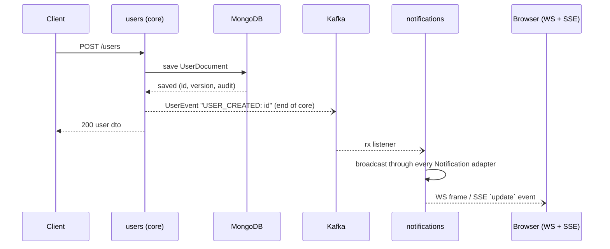
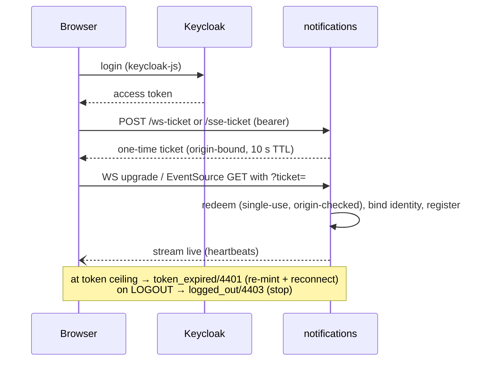
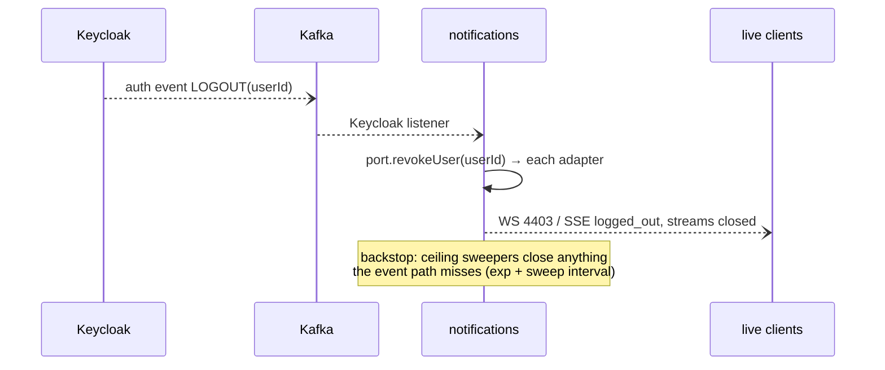

# ADR-0003: Application structure — users core, notifications feature, sample demos

- **Status:** Accepted
- **Date:** 2026-11-01
- **Context:** The template grew organically (`app/` vs `sample/` split, notification code under `app/user/notification`, WebSocket demo under `sample/websocket`, Kafka plumbing shared between them). Feature removal and responsibility ownership were hard to see. Supersedes the package layout described in ADR-0001/ADR-0002 (their decisions stand).

## Context

Three things were wrong with the old layout:

1. **Responsibilities were invisible.** The application core (`user` CRUD) and the
   optional notification feature (Kafka listener → SSE/WS broadcast) shared the `app/`
   namespace; `app → sample` imports were the only coupling points and had to be
   maintained by hand in the docs.
2. **The notification feature was spread over three packages** (`app/user/notification`
   for SSE, `sample/websocket` for WS, `app/ticket` for their shared auth) — removing
   or enabling "notifications" meant hunting across the tree.
3. **Pointless indirection.** `User`/`Permission` "domain" classes wrapped the Mongo
   documents one-for-one (`toDomain`/`toDocument` everywhere) without adding behavior.

## Decision

Three feature packages by responsibility + thin infrastructure, one direction of
dependency, Kafka as the explicit core→feature boundary:

```
com.softeno.template
├── users/          # APPLICATION CORE — user + permission, Mongo documents, event publish
├── notifications/  # OPTIONAL feature — one port (Notification), ws + sse adapters,
│                   # shared ticket auth, Kafka listeners (user events, Keycloak LOGOUT)
├── sample/         # removable feature demos (http, proto) — no longer contains websocket
├── common/         # BaseDocument, errors, principal utils (infrastructure)
└── config/         # security, http, opentelemetry, kafka wiring (infrastructure)
```

- **users (core):** owns `UserDocument`/`PermissionDocument` and the services over
  them — **no domain wrapper classes, the db documents are the model**. Its write
  path ENDS at publishing a `UserEvent` to Kafka (`UserEventsPublisher`, tx topic).
  The core does not know transports, tickets, or SSE/WS exist.
- **notifications:** consumes the core's events (rx topic) and Keycloak auth events,
  and translates them into the transports' languages. Optional: delete the package (plus
  its `SecurityConfig` rules and `com.softeno.{ticket,sse,ws}.*` keys) and the app still
  compiles and runs — user CRUD keeps working, broadcasts simply have no listeners.
  Internal structure is the hexagon of ADR-0004.
- **sample:** stays as is (http + proto demos); the WebSocket demo moved out — it is now
  a first-class notification adapter, not a sample.
- **common/config:** infrastructure only; they may be imported by anything, import nothing
  from the feature packages (exception: `config/kafka` wires the core's event type).
- **Dependency direction:** `sample → (common/config)`, `users → (common/config)`,
  `notifications → (users events, common/config)` — never feature → sample, never
  core → notifications. The old `app → sample` coupling points are gone.
- **Domain removal:** services return documents (plus a read tuple
  `UserWithPermissions(user, permissions)` of documents for joined reads); the REST/GraphQL
  wire contracts are unchanged.

### Functional view — user created (core → notifications)



### Functional view — subscribe (browser, ticket handshake)



### Functional view — logout / revocation



## Consequences

**Positive**
- Ownership is visible from the package name; the core→feature boundary is Kafka, so
  notifications is genuinely optional (no code changes to delete it beyond removing
  its own package + props + rules).
- No `app → sample` coupling points remain; the removal contract shrank.
- Fewer classes: no `User`/`Permission` wrappers, no `toDomain`/`toDocument` mappers.
- Tests mirror the same names (`users/`, `notifications/{ws,sse,ticket,kafka}`), so a
  failing test names its owning package.

**Negative / accepted costs**
- Big-bang rename — one commit, no behavior change; API contracts (REST/GraphQL JSON,
  WS wire format, SSE events) are byte-identical.
- The integration event type (`UserEvent`) lives with the core; `config/kafka` and
  `notifications` reference it — an accepted, one-directional dependency.
- `tx`/`rx` topic names keep their historical env-var names; the ADR documents their
  semantics: tx = core publishes, rx = notifications consumes.

## References

- ADR-0001 (WebSocket ticket auth), ADR-0002 (SSE ticket auth + lifecycle) — decisions
  unchanged, packages moved.
- ADR-0004 — the notifications hexagon (port/adapters).
