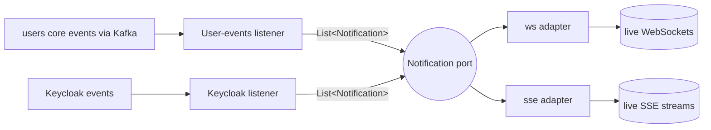

# ADR-0004: Notifications as a hexagon — one port, two adapters

- **Status:** Accepted
- **Date:** 2026-11-01
- **Context:** After ADR-0003, the notifications feature had one functionality (fan an event out to the user's live connections; revoke a user) but two transports wired to it by direct class references.

## Context

The Kafka listeners previously injected the concrete WebSocket service and the concrete
SSE emitter/registry and called both by hand. Every added transport (webhook, push,
gRPC stream, …) would mean editing both listeners, and the listeners had to know each
transport's revocation API. The functionality itself is transport-independent — only the
delivery is not.

## Decision

Structure `notifications` as a small hexagon:

- **One port** — `notifications/Notification.kt`:

  | Operation | Meaning |
  |---|---|
  | `broadcast(message)` | fan an event out to every live subscriber of this transport |
  | `revokeUser(userId)` | close everything live bound to this user; return the count |

- **Two adapters** implement it and own everything transport-specific:
  - `ws/WsNotification` — delegates to the session registry; control frames +
    4401/4403 close codes (ADR-0001); toggled by `com.softeno.ws.enabled`.
  - `sse/SseNotification` — delegates to the update emitter + subscription registry;
    named `token_expired`/`logged_out` events (ADR-0002).
- **Consumers depend on the port only.** The Kafka listeners (user events → broadcast,
  Keycloak LOGOUT → revoke) inject `List<Notification>` and loop — Spring collects
  every enabled adapter automatically.

## Consequences

**Positive**
- Adding a transport = one new `@Service` implementing the port; zero edits to the
  listeners or the other adapters.
- Each transport's toggle (`com.softeno.ws.enabled`) now genuinely removes its adapter
  from the fan-out (a disabled transport simply isn't in the list).
- Listener tests mock the port (two fake adapters), not real transports.
- The feature-removal contract simplifies: `notifications/` + props + rules.

**Negative / accepted costs**
- One extra indirection layer (two ~15-line adapter classes) — accepted: it is the
  seam that keeps the transports independent of the event sources.
- `broadcast` fan-out is sequential over adapters; with only in-process, non-blocking
  `trySend` calls per adapter, ordering and cost are irrelevant at template scale.

## References

- ADR-0003 (application structure), ADR-0001 / ADR-0002 (per-transport lifecycle contracts).
