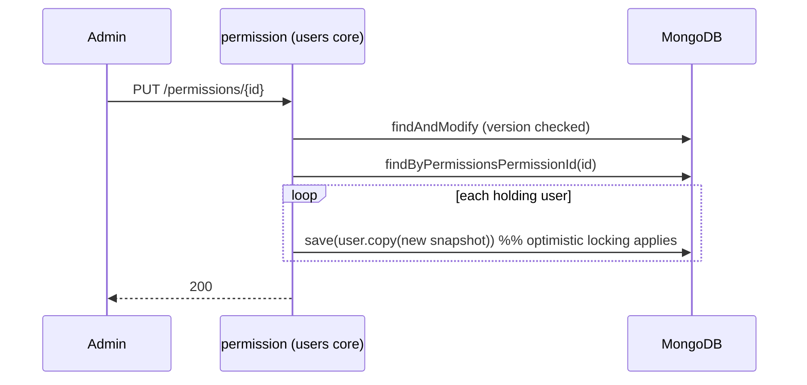

# ADR-0005: Embedded permission snapshots in users — fan-out on change

- **Status:** Accepted
- **Date:** 2026-11-01
- **Context:** Supersedes the read-tuple detail of ADR-0003 (`UserWithPermissions` + join on every read). The users core should read one document, and the model should be visible in the document itself.

## Context

ADR-0003 stored `UserDocument.permissions` as id references and joined permission
documents on every read (`resolvePermissions`, `getUsersWithoutPermissions`, a GraphQL
`@BatchMapping`). That worked but made the simple case awkward: every user read touched
two collections, and the read model needed a tuple type.

MongoDB's idiomatic answer for "always read together" data is embedding. Embedding has
one classic cost: **the copy can go stale** when the source (the permission) changes.

## Decision

`UserDocument.permissions: Set<PermissionSnapshot>` — a write-time copy of the permission
embedded in the user document — plus active propagation:

- **Create/update user:** id references in the command are resolved to permission documents
  and snapshotted (`PermissionSnapshot.of`) at write time; an unknown id still fails the write.
- **Update permission:** after the optimistic-locking write, `UserPermissionSync.syncPermission`
  replaces the snapshot in every user holding it.
- **Delete permission:** `pullPermission` removes the snapshot from every user.
- **Reads:** a single document, no joins — the tuple, resolver and batch mapping are gone.

### Deliberate modelling details

- `PermissionSnapshot` is a dedicated plain type, not `PermissionDocument`: embedding the
  repository document leaked its mapping annotations into the user collection (a unique
  `permissions.name` index appeared — `E11000` on the second user with the same role).
- Its id field is named `permissionId`, not `id`: a property named `id` is treated as the
  nested `_id` and made the fan-out query unmatchable.
- The fan-out uses fetch + `save` per affected user, not `saveAll` and not raw
  `arrayFilters`: coroutine `saveAll` does not apply version-checked updates to existing
  documents (verified empirically, Spring Data Mongo 5.1), and the reactive template did
  not pass array filters through. Affected-user sets are small by nature; the loop keeps
  optimistic locking intact.

## Consequences

**Positive**
- User reads are single-document; the read API shrinks (`get`/`getAll` return the document).
- REST/GraphQL wire contracts unchanged — the snapshot carries the same fields the join produced.
- No stale-by-neglect: updates and deletes propagate automatically.

**Negative / accepted costs**
- Duplication: a permission's name/description/version is stored once per holding user.
- The fan-out is **not atomic** with the permission write: a user read racing it may see
  the previous snapshot (one propagation behind); a user saved concurrently may keep the
  old snapshot until the next permission change. Acceptable for a template — strict
  consistency would need joins or transactions.
- Fan-out bumps each user's `version` (an admin editing a user while a permission changes
  can hit an optimistic-lock conflict — retry semantics unchanged).
- Schema evolution of the embedded shape needs a one-off collection migration — the
  template ships none; wipe dev collections after shape changes.

## References

ADR-0003 (structure — its read-tuple detail is superseded here), ADR-0004 (transports).
