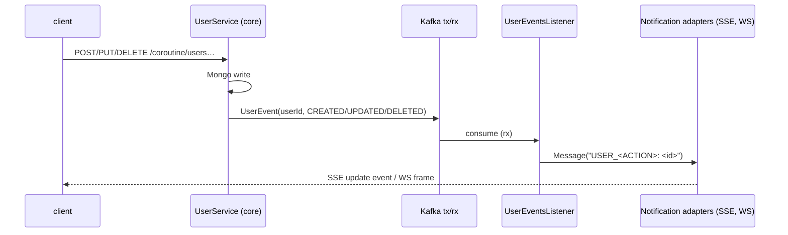

# ADR-0006: User lifecycle events — one wire type, action enum, broadcast only

- **Status:** Accepted
- **Date:** 2026-11-06
- **Context:** Supersedes the event-type detail of ADR-0003 (`UserCreatedEvent`). The core published an event only on user create; update and delete were silent, so SSE/WS clients never learned about most of the lifecycle.

## Context

`UserCreatedEvent(userId)` was the whole boundary: `UserService.create` published it,
`UserEventsListener` rendered `USER_CREATED: <id>` and fanned out through the
`Notification` port. Extending it naively means either three event classes that consumers
must disambiguate on the wire, or a growing pile of topic-specific handling.

Also: the `users/` domain is a **dummy template implementation**. Its `UserDocument.id`
is a Mongo id, not the Keycloak `sub` that live SSE/WS sessions are bound to — so these
events can be broadcasts, never revocation. Session revocation stays with the Keycloak
LOGOUT/admin-event listeners (ADR-0004/ADR-0005 era behavior).

## Decision

One wire type for the whole user lifecycle:

```kotlin
enum class UserAction { CREATED, UPDATED, DELETED }
data class UserEvent(val userId: String, val action: UserAction = UserAction.CREATED)
```

- **Publish points:** `UserService.create/update/delete` publish `CREATED/UPDATED/DELETED`
  after the DB write — the write path still ENDS at `UserEventsPublisher` (ADR-0003).
- **Consumer:** `UserEventsListener` parses `UserEvent` and renders
  `USER_<ACTION>: <id>` through `List<Notification>` — SSE and WS adapters are untouched
  (ADR-0004 holds: a new transport is a new adapter, never a new producer branch).
- **Compatibility:** the `action` default keeps pre-change payloads (`{"userId": …}`)
  readable as `CREATED`; no topic wipe needed.



## Consequences

**Positive**
- One event type covers the lifecycle; a new action is an enum case + render branch.
- Old payloads stay readable — dev topics need no wipe.
- Clients can keep their UI in sync (refresh/evict) without polling.

**Negative / accepted costs**
- Broadcast is fire-and-forget: a client offline during the event misses it (no replay) —
  acceptable for a template; real systems would need replay or polling.
- Events carry the app (Mongo) user id — deliberately NOT usable for session revocation,
  which stays the Keycloak listeners' job (see AGENTS: app users ≠ Keycloak users).

## References

ADR-0003 (structure — its `UserCreatedEvent` detail is superseded here), ADR-0004 (the
`Notification` port the listener fans out through).
